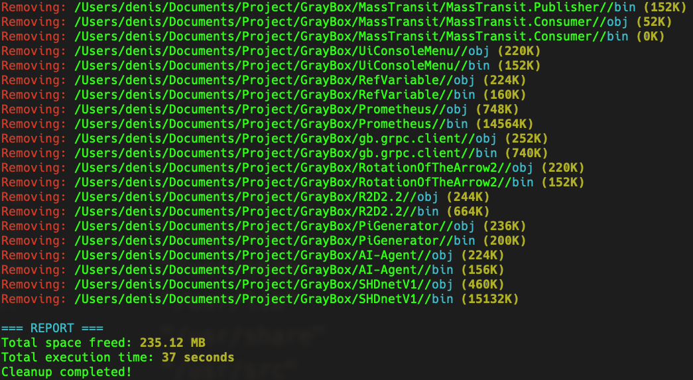

# CleanBinObj

**Русский** | [Английский](README.md)



Мощная утилита командной строки для очистки директорий `bin` и `obj` из ваших .NET проектов, освобождающая место на диске и поддерживающая чистоту в среде разработки.

## Возможности

- 🚀 **Быстрая и эффективная работа**: Быстро находит и удаляет все директории `bin` и `obj`
- 📊 **Подробная статистика**: Показывает общий объем освобожденного места и время выполнения
- 🎨 **Цветной вывод**: Удобное цветное отображение в консоли
- ⚡ **Умная фильтрация**: Автоматически пропускает директории `node_modules`
- 📏 **Форматирование размера**: Отображает размеры в удобных единицах (Б, КБ, МБ, ГБ)

## Требования

- Bash (Linux/macOS) или WSL/Git Bash (Windows)
- Базовые знания командной строки

## Установка

1. Клонируйте репозиторий или скачайте скрипт:
   ```bash
   git clone https://github.com/yourusername/CleanBinObj.git
   cd CleanBinObj
   ```

2. Сделайте скрипт исполняемым:
   ```bash
   chmod +x CleanerBinObj.sh
   ```

## Использование

1. Перейдите в директорию вашего проекта:
   ```bash
   cd /путь/к/вашему/проекту
   ```

2. Запустите скрипт:
   ```bash
   /путь/к/CleanerBinObj.sh
   ```

   Или если вы находитесь в директории со скриптом:
   ```bash
   ./CleanerBinObj.sh
   ```

## Пример вывода

```
Начинаю поиск и удаление директорий bin и obj...
Удаление: ./MyProject/bin (1.2 МБ)
Удаление: ./MyProject/obj (0.8 МБ)

=== ОТЧЕТ ===
Общий освобожденный объем: 2.0 МБ
Общее время выполнения: 1 секунда
Очистка завершена!
```

## Лицензия

Этот проект с открытым исходным кодом, доступный по лицензии [MIT](LICENSE).

## Вклад в проект

Вклад приветствуется! Вы можете отправить Pull Request.

## Автор

[Denis Yakushev] - [dennilen@gmail.com]
