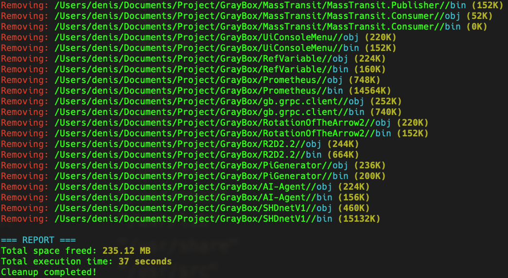

# CleanBinObj

**English** | [Russian](README-RU.md)



A powerful command-line utility to clean up `bin` and `obj` directories from your .NET projects, freeing up disk space and maintaining a clean development environment.

## Features

- 🚀 **Fast and Efficient**: Quickly finds and removes all `bin` and `obj` directories
- 📊 **Detailed Reporting**: Shows total space freed and execution time
- 🎨 **Colorful Output**: Easy-to-read colored console output
- ⚡ **Smart Filtering**: Automatically skips `node_modules` directories
- 📏 **Size Formatting**: Displays sizes in appropriate units (B, KB, MB, GB)

## Prerequisites

- Bash shell (Linux/macOS) or WSL/Git Bash (Windows)
- Basic command-line knowledge

## Installation

1. Clone this repository or download the script:
   ```bash
   git clone https://github.com/yourusername/CleanBinObj.git
   cd CleanBinObj
   ```

2. Make the script executable:
   ```bash
   chmod +x CleanerBinObj.sh
   ```

## Usage

1. Navigate to your project directory:
   ```bash
   cd /path/to/your/project
   ```

2. Run the script:
   ```bash
   /path/to/CleanerBinObj.sh
   ```

   Or if you're in the script's directory:
   ```bash
   ./CleanerBinObj.sh
   ```

## Example Output

```
Starting search and removal of bin and obj directories...
Removing: ./MyProject/bin (1.2MB)
Removing: ./MyProject/obj (0.8MB)

=== REPORT ===
Total space freed: 2.0 MB
Total execution time: 1 seconds
Cleanup completed!
```

## License

This project is open source and available under the [MIT License](LICENSE).

## Contributing

Contributions are welcome! Please feel free to submit a Pull Request.

## Author

[Denis Yakushev] - [dennilen@gmail.com]
